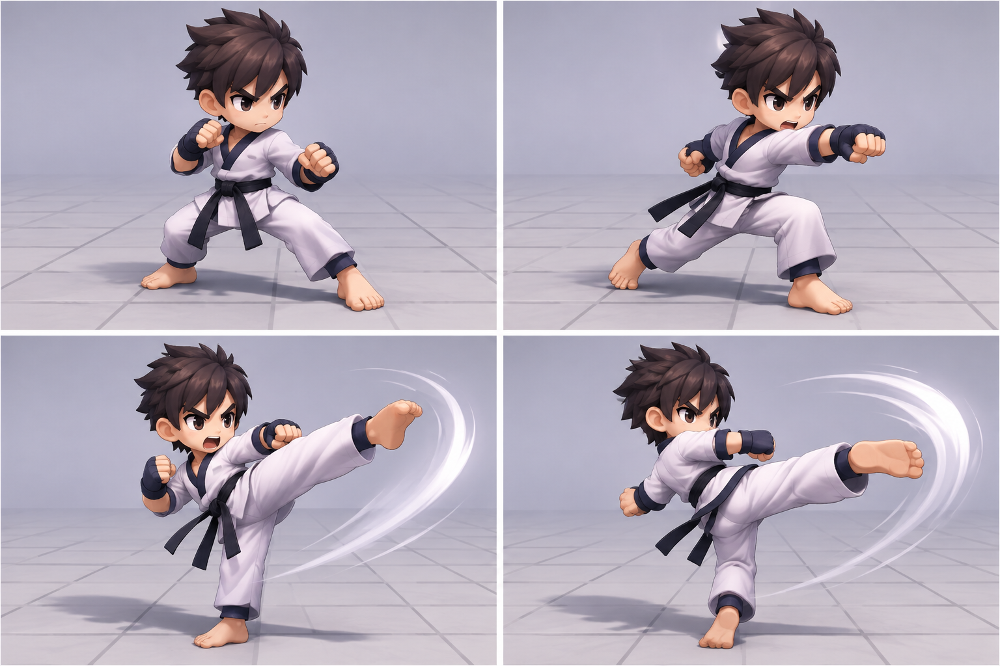
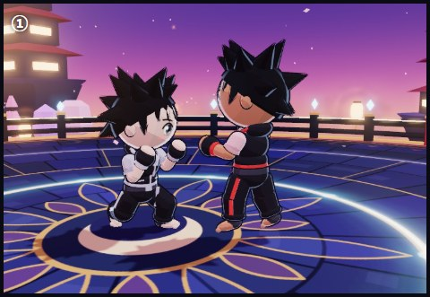
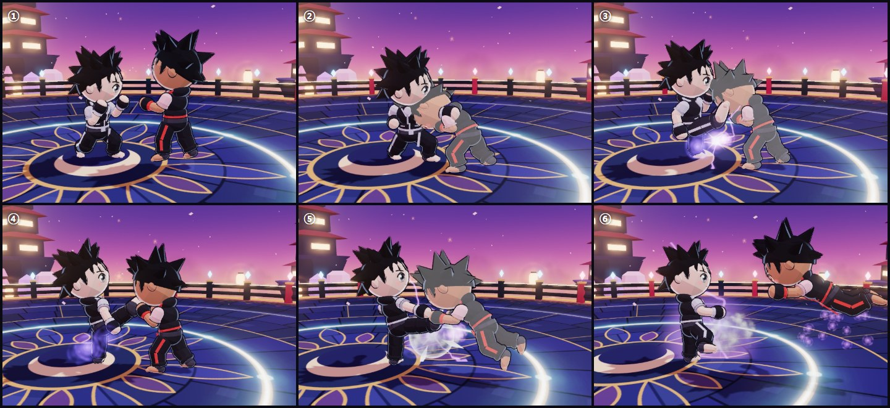
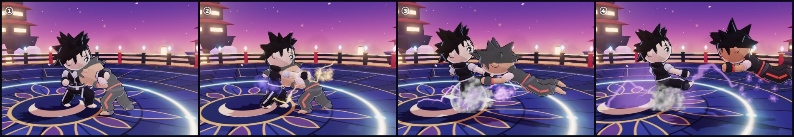

# 🥋 진태권도 (眞跆拳道)

> 품새의 앞굽이, 전진하는 강한 발차기, 텀을 두는 심리전

| 항목 | 내용 |
|---|---|
| 전투 유형 | 근접 격투 · 발차기 중심 |
| 강점 | 발차기 피해와 전진 거리, 긴 사거리 |
| 운영 | 맞힌 뒤 다음 타의 박자를 바꿔 가드·반격을 흔든다 |
| 약점 | 정권 발동이 태권도보다 느리다 · 잡기 범위가 좁다 |
| 능력치 | 속도 3 · 리치 5 · 콤보 4 · 파워 4 · 잡기 1 |

## 1. 기본 이미지

| 컨셉 | 게임 내 대기 자세 |
|---|---|
|  |  |

낮고 긴 앞굽이 자세. 앞 무릎을 깊게 굽히고 양 주먹을 올린다.

## 2. 동작 이미지

**X C C C — 정권 후 연속 발차기**

| 컷 | 동작 | 설명 |
|---|---|---|
| ① | 준비 자세 | 하체를 낮추고 양손을 올려 대비 |
| ② | 앞굽이 정권 | 앞발에 체중을 실으며 앞손을 곧게 지른다 |
| ③ | 밀어 앞차기 | 한 걸음 밀고 들어가며 몸통을 찬다 |
| ④ | 돌려차기 | 몸을 틀어 상체를 가격, 상대를 더 밀어낸다 |
| ⑤ | 회전 발차기 | 한 바퀴 돌아 회전력으로 마무리 |
| ⑥ | 다운 | 상대가 멀리 날아가 쓰러진다 |

**X X C — 정권 2연타 후 옆차기**

## 3. 콤보 커맨드

`X` = 손(P), `C` = 발(K)

| 커맨드 | 기술 구성 | 피해(단독 합) | 결과 | 용도 |
|---|---|---|---|---|
| `X X` | 앞굽이 정권 · 반대 지르기 | 30 + 38 | 경직 | 기본 견제 |
| `C C` | 밀어 앞차기 · 돌려차기 | 62 + 82 | 경직 · 밀어냄 | 거리 압박 |
| `C C C` | 앞차기 · 돌려차기 · 회전 발차기 | 62 + 82 + 120 | 다운 | 기본 콤보 |
| `X X C` | 정권 2연타 · 옆차기 | 30 + 38 + 95 | 다운 · 링아웃 | 연계 공격 |
| `X C C C` | 정권 · 앞차기 · 돌려차기 · 회전 발차기 | 30 + 62 + 82 + 120 | 다운 | 강력한 연계 |

공통: `V` 연타 난무(판당 1회) · 대시 `X` 아머 어택 · 대시 `C` 날라차기 · `Z+X` 엎어치기 · `Z+C` 반격 · `X+C` 회피.
실제 콤보 피해는 연타 보정으로 합계보다 조금 낮다 (예: `C C C` 238, `X C C C` 247).

## 4. 기술 설명

| 기술 | 피해 | 판정 | 경직/넉백 | 전진 | 비고 |
|---|---|---|---|---|---|
| 앞굽이 정권 | 30 | 손 · 발동 7F | 경직 22F | 중 | 앞손 지르기. `X`/`C` 로 이어짐 |
| 반대 지르기 | 38 | 손 · 발동 7F | 경직 24F | 중 | 뒷손. `C` → 옆차기 |
| 밀어 앞차기 | 62 | 발 · 리치 +15cm · 발동 10F | 경직 30F · 밀어냄 | **대** | 약 2.1m 밖에서도 닿는다 |
| 돌려차기 | 82 | 발 · 리치 +15cm · 발동 14F | 경직 32F · 밀어냄 | 대 | |
| 회전 발차기 | 120 | 발 · 리치 +15cm · 발동 17F | **다운** · 멀리 날림 | 대 | 3단의 마무리 |
| 옆차기 | 95 | 발 · 리치 +20cm · 발동 14F | **다운** · 링아웃 유리 | 대 | `X X C` 마무리 |

- **전진 발차기**: 모든 발차기가 앞으로 걸어 들어가며 나간다. 상대가 타격 거리 안에 들어오면 멈추므로 상대를 뚫고 지나가지 않는다.
- **텀 연계**: 타격이 맞으면 동작이 끝난 뒤에도 자세를 약 0.2초 더 유지한다. 그 사이에 다음 키를 눌러도 연계가 이어진다 (가드·점프·대시로 취소). 늦게 누르면 상대 경직이 풀려 확정 콤보는 아니게 되므로, 빠르게 이어 확정으로 넣을지 늦춰서 가드를 흔들지 고르는 심리전이 된다.
- 띄우기 기술은 없다.

## 5. 출처 구분

| 구분 | 내용 |
|---|---|
| 원작에서 참고한 방향 | 태권도 강화형 비전서 · 공격 사이에 텀을 둘 수 있음 · 발차기 피해와 전진 거리가 우수 |
| 신규 설계 (이 게임 고유) | 모든 모션, 기술 이름, 커맨드 5종, 피해·경직·전진 수치, 텀 연계 규칙 |

테스트: `node tools/test-rules.mjs` 의 "진태권도" 7항목.
